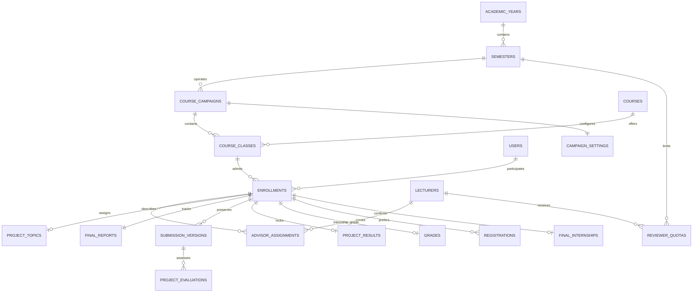
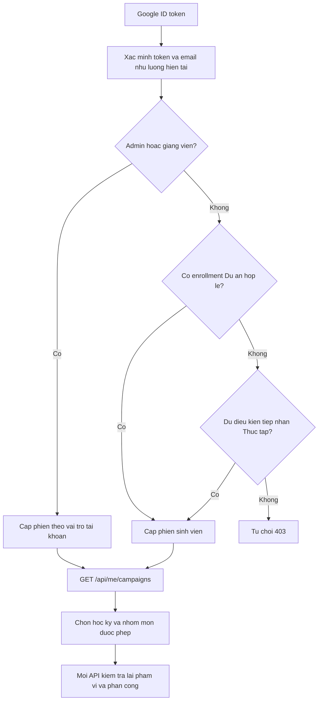
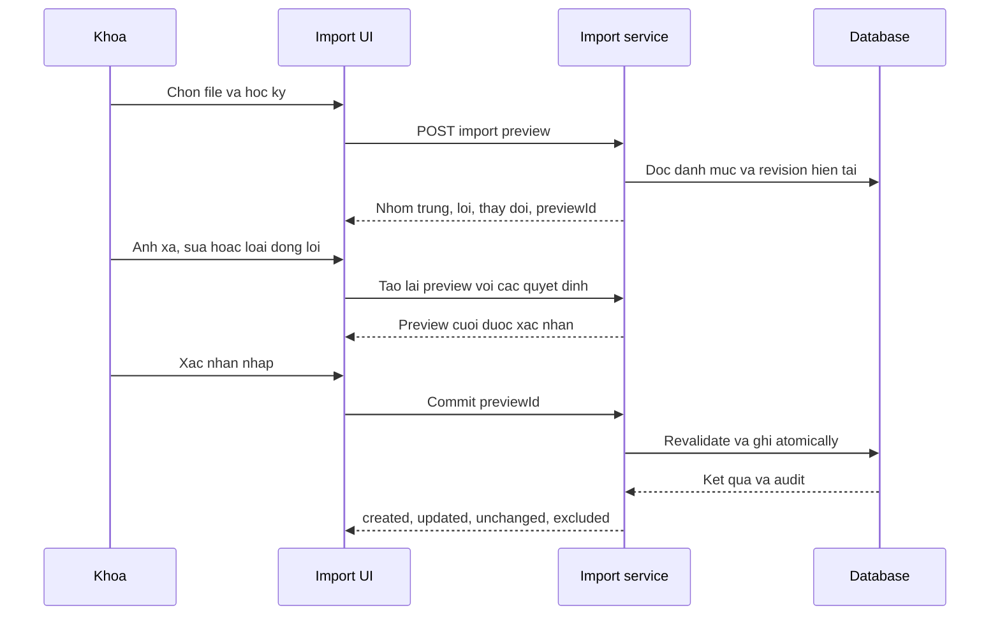

# Thiết kế hệ thống Thực tập và Dự án theo học kỳ

Ngày cập nhật: **29/10/2026**. Cơ sở nghiệp vụ: [REQUIREMENTS.md](REQUIREMENTS.md). Hướng dẫn vận hành bản hiện có: [README](../README.md).

**Đã cài đặt phần mở rộng trên backend Express và giao diện React.** Mục 2 là mô hình nghiệp vụ và phương án chuẩn hóa; [mục 12](#12-cai-dat-thuc-te-trong-repository) mô tả lưu trữ/API hiện đã có và khác biệt với thiết kế đích. [Hướng dẫn triển khai](IMPLEMENTATION_STATUS.md) ghi lệnh chạy, kết quả kiểm thử và ranh giới nghiệm thu. Ngày 29/10/2026 đã chuyển dữ liệu vào Turso vận hành sau sao lưu/diễn tập; [quy trình phát hành](PRODUCTION_RELEASE.md) mô tả kiểm tra đúng phiên bản Render/Pages.

## 1. Kiến trúc hiện tại và điểm cần chuyển đổi

### 1.1. Thành phần đang có

| Thành phần | Nguồn hiện tại | Trách nhiệm |
| --- | --- | --- |
| Frontend | `src/App.tsx`, `src/app/AppRoutes.tsx`, `src/auth/access.ts` | Google OAuth, shell, route/guard theo vai trò |
| Các feature | `src/features/{student,lecturer,admin,shared}` | Màn hình theo vai trò; thành phần dùng chung ở `src/shared` |
| API chính | `server.ts` → `server/index.ts` → `server/app.ts` | Express, Vite khi phát triển, static frontend khi production; route theo chức năng |
| Xác thực | `server/routes/auth.routes.ts`, `server/middlewares/auth.ts` | Xác minh Google token, JWT, đọc lại user từ DB; `getActorLecturer` nhận diện Admin kiêm GV |
| Database | `server/db.ts`, `server/db/initDb.ts` | D1 REST adapter hoặc libSQL/Turso; khởi tạo schema và các sửa đổi lịch sử |
| Storage | `server/services/storage.ts` | R2 qua S3 API; local `.storage` khi không phải production |
| Tích hợp | Service email, notifications, googleSheets, autoReminders và route cron | Thông báo web, quota/hàng đợi email, Sheets, nhắc hạn |
| Backend phụ | `src/worker.ts`, `wrangler.toml` | Worker/D1/R2; workflow deploy Worker hiện đã tắt |

Chọn DB trong `initDb`: `DB_PROVIDER` tường minh được ưu tiên; nếu không đặt thì có D1 token sẽ chọn D1, còn lại chọn Turso/libSQL. Không có kết nối remote ở môi trường phát triển thì nhánh libSQL dùng `file:./internship-db.db`. Không suy ra production đang dùng provider nào chỉ từ README hoặc `.env.example`.

Các bảng hiện có gồm user, giảng viên, doanh nghiệp, nguyện vọng, nơi TT chính thức, phân công/đề xuất/quota GVHD, báo cáo, điểm, chat, thông báo và settings. `users.course_code` và cấu hình đợt dùng chung chưa biểu diễn được nhiều lần học.

### 1.2. Các ràng buộc từ mã Thực tập cũ

- `final_internships`, `final_reports`, `grades`, `advisor_requests` có khóa duy nhất theo `user_id`; primary cũng duy nhất theo user. Phải đổi sang lần học trước khi dùng chung các kỳ.
- OAuth SV hiện kiểm tra khóa và ngoại lệ SV đã có trong DB. Danh sách Dự án là nguồn cấp quyền riêng, không đi qua ngoại lệ khóa để mở mọi lớp.
- `getPrimaryLecturerForUser` đã được sửa để bắt buộc `role = 'primary'`; nhận diện GV dùng email danh mục thay cho tên hiển thị. Kiểm thử hồi quy chặn đồng HD và tài khoản trùng tên nhập thay điểm.
- Helper import hiện đọc sheet đầu; UI dò cột gần đúng. Import Dự án phải phân biệt `Mã SV`/`Mã LMH`, đọc hai sheet và giữ kiểu ngày/nguồn ô để đối soát.
- Key PDF `reports/{year}/{student}/final.pdf` và cache theo user chưa đủ phân biệt lớp/phiên bản.
- `executeBatch` chia lô 50 câu lệnh, không phải cam kết transaction toàn tác vụ nhiều lô hoặc cho cả DB và R2.
- Giao diện mở rộng dùng [UI_DESIGN_SYSTEM.md](UI_DESIGN_SYSTEM.md), UI primitives/tokens hiện có và header FIT UET; không tái áp dụng thông số Apple HIG cũ khác bộ tokens hiện tại.

## 2. Ranh giới nghiệp vụ và mô hình dữ liệu đích

### 2.1. Cấu trúc dữ liệu



`CourseCampaign` là nhóm môn vận hành trong một học kỳ; `Course` là danh mục; `CourseClass` là lớp trực thuộc; `Enrollment` là khóa nghiệp vụ. Tên bảng trong sơ đồ tương ứng snake_case bên dưới. Danh mục user/GV/DN dùng chung, không sao chép giảng viên theo nhóm môn.

### 2.2. Các bảng và khóa quan trọng

Đây là phương án chuẩn hóa dài hạn, không phải schema vật lý của bản cài đặt này hoặc SQL chạy trực tiếp trên production. Bản hiện tại dùng lớp lưu trữ bổ sung ở mục 12 và giữ nguyên unique/FK của dữ liệu Thực tập cũ. Chỉ rebuild/backfill theo mục 10 khi thực hiện một đợt cutover riêng.

| Bảng | Dữ liệu chính và ràng buộc |
| --- | --- |
| `academic_years` | id, start_year, end_year; unique start_year, end_year = start_year + 1 |
| `semesters` | id, academic_year_id, term = `1/2/summer`; unique(year, term) |
| `courses` | id, code unique, name, group = `internship/project`; seed INT4002, INT3508, INT4003, INT3132, INT3131 |
| `course_campaigns` | id, semester_id, group, status = `draft/active/archived`, settings, revision; unique(semester_id,group) |
| `course_classes` | id, campaign_id, course_id, section, code, revision; unique(campaign,course,section); trạng thái/cấu hình kế thừa campaign |
| `enrollments` | id, class_id, user_id, status = `active/withdrawn`, registration_note, snapshot tên/ngày sinh/lớp khóa học, source, revision; unique(class_id, user_id) |
| `campaign_settings` | Cấu hình chung theo campaign_id; lớp kế thừa hạn/nội dung/trạng thái, không có ghi đè riêng |
| `advisor_assignments` | id, enrollment_id, lecturer_id, role = `primary/co/reviewer`, trạng thái hiện hành, người/thời điểm gán, ghi chú/liên hệ; lịch sử riêng |
| `project_topics` | enrollment_id PK, title, trạng thái/phiên bản đề tài, nguồn công nhận, người/thời điểm duyệt, revision; chỉ dùng cho project |
| `final_reports` | id, enrollment_id unique, current_version_id, report_status, submission_locked_at, submission_reopen_until, revision; con trỏ bộ bài hiện hành |
| `submission_versions` | id, enrollment_id, version_no, state = `empty/editing/submitted`, snapshot đề tài, PDF metadata, slides_url, demo_url, người/thời điểm tạo, nguồn mở lại; unique(enrollment, version_no) |
| `project_evaluations` | id, submission_version_id, assignment_id, lecturer_id, role = `advisor/reviewer`, score, comment, submitted/updated_at; unique(version, role) |
| `project_results` | enrollment_id PK, locked_version_id, locked_at, locked_by; tổng kết là projection từ hai đánh giá hiện hành, không phải nguồn điểm thứ ba |
| `grades` | Điểm TT giữ progress/report/company, final_score, comment, submitted_at, locked_at; đổi unique(user_id) sang unique(enrollment_id) |
| `reviewer_quotas` | PK(semester_id, lecturer_id), max_reviews nullable; null = không đặt trần, 0 = không nhận thêm |
| `lecturer_quotas` | PK(semester_id, lecturer_id), quota HD TT tính gộp các lớp TT trong kỳ; backfill quota cũ vào Hè 2025–2026, không dùng cho HD/NX Dự án |
| `internship_advisor_settings` | semester_id PK, các mức mặc định quota GS/PGS, TS, ThS/khác của TT; không nhân theo số lớp |
| `audit_events` | Scope semester/class/enrollment/version, actor, action, before/after, reason, timestamp, operation_id; append-only |
| `operation_previews` | Admin, loại import/auto-review, snapshot nguồn/đề xuất, digest, expires_at, trạng thái/kết quả commit chống replay |
| `migration_mappings` | migration_version, source_table/source_id, target_table/target_id, class/enrollment, checksum, trạng thái đối soát; unique khóa nguồn/đích |

`registrations`, `final_internships`, `advisor_requests`, lịch sử phân công và điểm TT phải mang enrollment_id. Unique hiện theo user chuyển theo enrollment. user_id nếu giữ cho adapter chỉ là trường suy ra, không dùng chọn lớp hoặc làm nguồn phân công.

Ràng buộc bắt buộc:

1. Partial unique cho tối đa một primary và một reviewer hiện hành/enrollment; unique(enrollment, lecturer, role) với phân công hiện hành. Reviewer không trùng primary/co; CN không primary/reviewer. Kiểm tra trong cùng transaction với ghi dữ liệu.
2. Con trỏ version và đánh giá phải có FK/kiểm tra bảo đảm version thuộc đúng enrollment; assignment đánh giá cùng enrollment/GV/vai trò. Giữ assignment đã thay làm lịch sử, không cascade xóa đánh giá.
3. Enrollment withdrawn thu hồi quyền SV và quyền ghi của GV đối với lần học đó; giữ dữ liệu cho Khoa. Tái tiếp nhận cùng lớp khôi phục enrollment, không nhân bản hoặc tự mở khóa bài.
4. Không dùng users.course_code để suy ra quyền; không ánh xạ giảng viên chưa xác định bằng tên và `LIMIT 1`.
5. Danh mục/lớp đã có dữ liệu dùng lưu trữ/rút, không cascade mất điểm/file/audit. Chỉ xóa vật lý thực thể nháp không có phụ thuộc.
6. Điểm hữu hạn 0–10, trọng số theo course.group; API TT không ghi đánh giá Dự án và ngược lại.

### 2.3. Cấu hình chung theo nhóm môn/học kỳ

| Nhóm khóa | Phạm vi |
| --- | --- |
| registration_open_at/close_at, confirmation_open_at/close_at, advisor_request_open_at/close_at, khóa được phép/ngoại lệ | Chỉ TT |
| topic_open_at/close_at | Chỉ Dự án |
| final_report_open_at/close_at, grading_open_at/close_at | Cả hai nhóm |
| Kế hoạch, quy định, FAQ theo vai trò, hướng dẫn GV, notify_on_grade_submission | Theo campaign, khởi tạo từ template đúng nhóm môn |

Settings toàn cục giữ tích hợp/vận hành chung như Sheets/email. Campaign native là nguồn hạn/nội dung/trạng thái cho các lớp trực thuộc; nhóm/kỳ khác độc lập. Campaign TT legacy dùng adapter các key nguồn cũ, không tạo nguồn ghi thứ hai.

Quota HD Thực tập thuộc học kỳ, tính gộp primary/co trên các lớp TT, giữ mức mặc định GS/PGS 5, TS 8, ThS/khác 10 và ghi đè từng GV. Các mức mặc định lưu ở internship_advisor_settings theo semester_id; không nhân quota khi chia đợt cũ thành nhiều lớp và không cộng sinh viên Dự án vào tải TT. Đây là cấu hình theo nhóm TT trong kỳ, độc lập thời hạn/nội dung của nhóm Dự án.

Input thời gian là ISO 8601 có offset, lưu UTC, hiển thị `Asia/Ho_Chi_Minh`. Điều kiện ghi: campaign/enrollment active, đúng quyền, `open <= now <= close`, đầu/cuối null là không giới hạn. Draft/archived vẫn chặn ghi. submission_reopen_until cấp hạn sửa riêng cho enrollment; mở khóa điểm không tự gia hạn chấm. Mốc mở sau đóng là lỗi validation.

## 3. Xác thực, chọn nhóm môn và phân quyền

### 3.1. Luồng xác thực đích



Giữ `POST /api/auth/google` và token tài khoản; không đưa classId cố định vào JWT làm nguồn cấp quyền. Email Google xác định MSSV, bảo toàn hồ sơ import. Tư cách Dự án là enrollment active trong class active/archived; archived cho xem lịch sử, draft chưa cấp quyền SV. Người chỉ hợp lệ TT chưa tự có quyền Dự án.

Tiếp nhận TT mới: backend kiểm tra khóa/ngoại lệ của lớp, mã học phần/hồ sơ và hạn đăng ký, rồi tạo enrollment khi SV tham gia lớp TT đó. Không dùng đường này cho Dự án. Tài khoản tồn tại trong users chỉ giữ ý nghĩa ngoại lệ TT hiện có, không cấp tư cách Dự án.

GET /api/me/campaigns trả nhóm được phép; GET /api/me/classes tương thích trả lớp đã tham gia/được phân công, toàn bộ lớp cho Admin, và các lớp TT mà SV đủ điều kiện tham gia với capability canJoin. Lớp TT chưa tham gia chỉ cung cấp thông tin kế hoạch/tiếp nhận, chưa cho xem danh sách SV/bài/điểm. Không liệt kê Dự án chưa có tên trong danh sách như lớp có thể tự tham gia.

### 3.2. Chuỗi kiểm tra quyền

Service/guard đích gồm `requireCampaignAccess`, `requireCampaignWritable`, `requireClassAccess`, `requireEnrollmentAccess`, `requireEnrollmentAssignment(role)`, `requireClassWritable`, `requireGradingWindow`. Backend tra DB mỗi lần truy cập, không dựa vào ẩn nút hoặc cache danh sách lớp.

1. Xác thực JWT/user hiện tại, tra lecturer bằng định danh đã ánh xạ; Admin kiêm GV dùng nguyên tắc getActorLecturer.
2. Giải enrollment → class → campaign → semester/course; classId trong URL/body phải khớp, không dùng classId khác né quota/khóa.
3. SV sở hữu enrollment active; GV có phân công hiện hành; Admin có quyền quản trị. Áp dụng [ma trận quyền](REQUIREMENTS.md#22-ma-tran-quyen-du-an), gồm đồng HD không đọc điểm Dự án.
4. Ghi qua trạng thái campaign/hạn/khóa; primary mới ghi TT, advisor/reviewer chỉ ghi phần Dự án của mình.
5. Tải file kể cả If-None-Match phải kiểm tra quyền trước trả bytes/304. Rút lớp/thay GV thu hồi quyền dù JWT còn hạn.

DTO SV whitelist thông tin lớp, đề tài, phân công, bài nộp và phản hồi sửa bài. Không serialize điểm qua spread hàng DB; nhận xét chấm nội bộ tách khỏi lý do sửa gửi SV. `GET /api/grades/my` cũ tiếp tục bị từ chối; notification hoàn tất không chứa điểm.

### 3.3. Context giao diện

App.tsx giữ auth; AcademicHome chọn học kỳ/nhóm và CampaignWorkspace giữ campaignId, semesterId, nhóm môn, bộ lọc lớp và capability từ server. AppRoutes.tsx vẫn ánh xạ route/guard; feature gọi API theo context. Capability chỉ điều khiển hiển thị.

- SV: lớp được phép, dashboard theo nhóm; Dự án có đề tài, GVHD/GVNX, bài nộp; TT giữ nguyện vọng/xác nhận nơi TT.
- GV: lọc kỳ/lớp/vai trò; panel bài và phần điểm mình, phần người còn lại read-only nếu đủ quyền.
- Khoa: nhóm/kỳ và bộ lọc lớp, import đối soát, phân công/preview GVNX, tiến độ và bảng điểm/export.
- Đổi nhóm/kỳ hủy request cũ, reset form và xóa cache PDF; response muộn không ghi context mới. Route chung là `#/campaigns/:campaignId?tab=...&classId=...`; `#/classes/:classId` chuyển đến nhóm với bộ lọc lớp tương ứng. Các route tác vụ TT cũ mở tab của campaign legacy.

## 4. Import danh sách và phân công GVHD Dự án

### 4.1. Hợp đồng chuẩn hóa

Server đọc workbook gốc, giữ kiểu ngày, sheet/hàng, formula/cached value; UI không là nguồn xác thực. Chỉ chọn DACN/DAKH mặc định. Ánh xạ header sau chuẩn hóa Unicode/khoảng trắng:

| Header SRC-03 | Đích |
| --- | --- |
| Mã SV | user.student_id, email MSSV@vnu.edu.vn |
| Họ và tên, Ngày sinh, Lớp khóa học | Hồ sơ và snapshot enrollment; khác lớp học phần |
| Mã LMH | course.code + section, tra lớp hoặc dự kiến tạo lớp draft trong kỳ Khoa chọn khi commit |
| Ghi chú cột G | registration_note: ĐK lần đầu/Học lại/Học tự do |
| GVHD, Email của GVHD | Ánh xạ primary/co bằng danh mục GV |
| Chủ đề, Ghi Chú cột K | Tên đề tài và ghi chú nghiệp vụ riêng |

Không dò bằng includes('mã') vì có hai loại mã. Không coi STT, ô hướng dẫn L/R hoặc thống kê là sinh viên. Sheet/header lạ được báo không hỗ trợ, không tự dùng layout V1/V2.

- MSSV dạng số khoa học đọc thành số nguyên chính xác rồi chuỗi 8 chữ số. Chuỗi giữ nguyên, không tự thêm số 0 để sửa. Dòng 338/DACN có 134 là lỗi, không suy ra MSSV từ tên.
- Ngày Excel theo date system 1900/1904; ngày chuỗi dd/mm/yyyy/ISO kiểm tra lịch; lưu YYYY-MM-DD, không chuyển timezone làm lệch ngày.
- Unicode NFC, khoảng trắng, email chữ thường. Công thức chỉ lấy cached value làm đầu vào cần kiểm tra, không thực thi tùy ý hoặc gọi link ngoài; thiếu cache email vẫn phải đối chiếu danh mục.
- So email và tên GV đồng thời. Bỏ tiền tố học hàm/học vị chỉ để tìm ứng viên, không dùng tên gần đúng để tự gán. Email cá nhân ánh xạ về GV có email VNU theo quy tắc OAuth, không tự tạo tài khoản GV mới.
- Nhiều tên một ô phải Khoa tách primary/co. Xác định CN từ danh mục chuẩn, không từ việc file bỏ tiền tố. Tên/email chưa khớp phải giải quyết trước commit hoặc loại rõ phần phân công đó.

### 4.2. Gộp, xem trước và commit

Khóa gộp là semester + course class + MSSV. Giá trị giống nhau gộp; ô trống bổ sung từ giá trị duy nhất khác; khác nhau cùng trường tạo conflict. Giữ nguồn sheet/hàng. Hiện trước/sau với dữ liệu hệ thống; ô trống không xóa giá trị hiện có.



Preview theo Admin, mặc định hết hạn sau 30 phút, không ghi user/lớp/enrollment/phân công thật. Server áp sửa/loại dòng vào dữ liệu gốc rồi tạo preview cuối. Commit chỉ nhận preview cuối, kiểm digest/revision nguồn/lớp/danh mục; lỗi hoặc stale trả 409/422, không công bố một phần lớp.

PreviewId đã commit trả kết quả cũ. Nhập lại file tạo preview mới nhưng unique danh tính/enrollment/assignment ngăn nhân bản. Không xóa SV vắng file, không tự khôi phục withdrawn, không ghi điểm/file hoặc đổi đề tài/người chấm khi đã có điểm. Trường hợp đó dùng mở lại riêng. SV chưa có GVHD vẫn được nhận.

## 5. Tự phân công GVNX

### 5.1. Nguồn và tải

Phạm vi chạy một lớp hoặc cả kỳ; pool/tải/trần luôn **toàn học kỳ**, gộp INT3131/INT3132. Pool có lecturer đủ định danh đang primary/co cho enrollment active của lớp Dự án active trong kỳ, loại CN. Reviewer không tự làm phát sinh tư cách hướng dẫn.

SV đích phải có primary. Loại primary, mọi co, người hết trần. So work_unit đã chuẩn hóa chính xác với primary; thiếu/không xác định đơn vị thì không đoán chuyên môn, dùng fallback có nhãn missing_work_unit.

Tải gồm reviewer hiện hành trên enrollment active toàn kỳ, kể cả đã chấm, cộng đề xuất cùng preview. Null không trần, 0 không nhận thêm. Giảm trần thấp hơn tải cũ không xóa phân công nhưng cảnh báo và chặn bài mới. Quota HD Thực tập không tham gia.

### 5.2. Thuật toán preview và áp dụng

1. Giữ reviewer đã có; chỉ xét enrollment chưa có. Thiếu primary trả missing_primary.
2. Xét trước SV ít ứng viên hợp lệ hơn; hòa thì enrollmentId tăng dần để preview ổn định.
3. Lấy nhóm cùng work_unit còn trần; nếu rỗng lấy pool hợp lệ khác đơn vị và đánh dấu cross_work_unit.
4. Chọn người ít bài reviewer hơn; hòa thì lecturerId tăng dần; cập nhật tải tạm trước SV tiếp theo.
5. Hết ứng viên trả no_eligible_reviewer/quota_exhausted, giữ chưa phân công. Đây là chia tuần tự cho Khoa rà soát, không cam kết tối ưu toàn cục.
6. Preview hiện primary/co, đơn vị, reviewer, tải trước/sau, trần, lý do ưu tiên/fallback, danh sách chưa gán. Khoa sửa phương án nhưng cùng ràng buộc pool/xung đột/trần.
7. Apply revalidate pool, phân công, revision và tải trong transaction; stale trả 409. Không dùng INSERT OR REPLACE đè người đã gán; apply lại previewId trả kết quả cũ.

Gán tay dùng cùng service. Đổi primary/co phải kiểm tra reviewer không trùng; thay đổi liên quan thực hiện trong một tác vụ. Sau bất kỳ điểm Dự án, thay người chấm/đổi snapshot đề tài phải mở lại bài để không kế thừa điểm người cũ. Không tự chạy phân công khi đọc trang hoặc sửa danh mục GV.

## 6. Bộ bài nộp, phiên bản và hai phần đánh giá

### 6.1. Nộp bài và lưu trữ

Mỗi enrollment có final_reports và version đầu `empty`, hỗ trợ chưa nộp vẫn được ghi điểm 0 có lý do. Version snapshot tên đề tài, PDF, slide/demo. Dự án chỉ submitted khi đủ bốn thành phần; TT chỉ yêu cầu PDF. Thay nội dung tạo version mới, không ghi đè snapshot cũ. Không có PDF không được accepted giả dù đã đủ điểm.

- PDF: .pdf, MIME application/pdf, kiểm chữ ký PDF, giới hạn `10 * 1024 * 1024` bytes; UI cùng giới hạn; tên file được làm sạch.
- Link HTTPS đến drive.google.com hoặc docs.google.com; không nhận javascript/data URL. Lưu URL, không tải slide/video về R2 hoặc mở Drive bằng service account.
- Nhắc SV cấp quyền xem. Validation URL không xác nhận quyền Drive. Khóa URL không khóa nội dung bên ngoài: hệ thống bảo toàn PDF và metadata/link đã khai, không cam kết version nội dung Drive.
- Key mới: `reports/{semesterId}/{classId}/{enrollmentId}/{versionNo}/{objectId}.pdf`, dùng ID server. Đổi riêng link có thể tham chiếu PDF version cũ; chỉ xóa object khi không version nào tham chiếu.
- Upload object trước, kiểm lại quyền/hạn/khóa/revision và commit DB sau. Lỗi DB dọn object mới, không xóa file cũ. DB và R2 không có chung transaction.
- Giữ lịch sử/file qua các kỳ, không tự xóa khi mở kỳ mới hoặc mặc định dung lượng nhiều kỳ nằm trong mức miễn phí cố định.

Tên đề tài chấm/xuất là snapshot lúc nộp. Sau điểm đầu tiên, khóa cả snapshot và bộ bài; sửa tên làm đổi snapshot cần Khoa mở lại. Trước chấm, SV sửa tên chuyển Pending; chỉ GVHD chính được duyệt/sửa rồi duyệt. Đổi tên sau nộp bắt buộc nộp lại theo topicVersion; duyệt muộn mở quyền nộp riêng đến hết hạn chấm. Xem [Duyệt đề tài](TOPIC_APPROVAL.md) cho quyền, thời gian và chuyển đổi metadata.

### 6.2. Trạng thái và mở lại

Bộ bài, tiến độ hai GV và khóa điểm là ba trục riêng. Không suy ra đã chấm chỉ từ report_status.

| Tình huống | Bộ bài | Điểm / tổng kết | Quyền sửa bài |
| --- | --- | --- | --- |
| Chưa đủ thành phần | empty/editing | Thiếu phần nào thì null | Trong hạn, chưa có điểm |
| Nộp đủ, chưa có điểm | submitted | Chờ cả hai GV | Trong hạn |
| Một GV đã nộp | Giữ trạng thái nộp thật | Một điểm; tổng null | Khóa, Khoa mới mở lại |
| Đủ hai phần cùng version/phân công | Giữ trạng thái nộp thật | Tính tổng | Khóa |
| Khoa khóa điểm | Không đổi bộ bài | locked_version_id cố định | Chặn mọi sửa điểm/bài |
| Khoa mở lại bài | Version mới editing | Hai phần hiện hành trống | Đến hạn riêng được cấp |
| Bỏ môn, chưa nộp | empty/editing | Mỗi GV nhập 0 có lý do; đủ hai phần tổng 0.0 | Điểm đầu tiên vẫn khóa bài |

GVHD/GVNX có thể yêu cầu sửa hoặc hủy yêu cầu, lý do gửi SV tách nhận xét chấm nội bộ. Yêu cầu chỉ cho nộp trong hạn khi chưa có điểm; sau điểm/quá hạn phải Khoa mở lại; hủy yêu cầu không tự đổi điểm/tạo file.

Mở lại cần reason và submissionUntil; điểm đã khóa phải mở khóa trước, audit cả hai hành động. Tạo version mới từ bản hiện tại, đổi current_version_id, bỏ khóa nộp vòng mới; không copy điểm. SV xác nhận nộp lại dù giữ nguyên file/link. Điểm/version cũ giữ cho Khoa. Hạn chấm không tự đổi.

### 6.3. Ghi và tính điểm

Role đánh giá advisor ứng với primary, reviewer ứng với reviewer. AssignmentId/lecturerId lấy từ actor/DB, không tin client. Request gồm score số hữu hạn 0–10, comment, submissionVersionId, expectedRevision. Điểm 0 bắt buộc lý do; khi chưa có bundle đầy đủ chỉ cho điểm 0 có lý do. Không tự điền phần người còn lại hoặc thêm nút điền nhanh 0.

Ghi điểm kiểm tra trong cùng tác vụ: đúng assignment, lớp/enrollment active, đúng hạn, version hiện hành, chưa khóa, bài submitted hoặc ngoại lệ 0. expectedRevision của tác vụ đánh giá là revision của final_reports; thay bài, ghi/sửa điểm hoặc thay phân công ảnh hưởng vòng chấm phải tăng revision này. Điểm đầu tiên đặt submission_locked_at. Sửa điểm lưu audit trước/sau. Lưu là đã nộp về Khoa, không có trạng thái draft hoặc bước lưu nháp điểm.

```text
advisor_score = điểm advisor của version và phân công hiện hành, hoặc null
reviewer_score = điểm reviewer của version và phân công hiện hành, hoặc null
final_score = null nếu một trong hai phần null
final_score = round_half_up(0.6 * advisor_score + 0.4 * reviewer_score, 1) nếu đủ
```

Làm tròn thập phân một lần ở tổng cuối; không kiểm truthy khiến mất điểm 0. Ví dụ 8.0/8.5 → 8.2; 0/10 → 4.0; 0/0 → 0.0. Hai GV thấy phần đã nộp của nhau ngay, đồng HD/SV không nhận DTO điểm. TT giữ đủ ba điểm 20/20/60 và chỉ primary ghi.

Khóa Dự án chỉ khi đủ hai phần hiện hành, ghi đúng locked_version_id. Bulk lock báo skipped và lý do nếu thiếu, không coi thiếu là 0. Mở khóa cho sửa trong hạn, không cho thay bài. Khoa không có endpoint nhập thay; Admin kiêm GV chỉ chấm đúng phân công.

## 7. Hợp đồng API đích và tương thích

### 7.1. Quy ước

API mới trả lỗi `{ error: { code, message, details? } }`: 401 chưa xác thực; 403 thiếu quyền/hết hạn; 404 không có hoặc không tiết lộ; 409 stale/khóa/xung đột; 422 dữ liệu sai, 413 file quá lớn. Adapter giữ wire shape cũ khi cần. API campaign trả `{ items, total, studentCount, page, limit, totalPages }` sau lọc quyền/nhóm/lớp, mặc định 25 hồ sơ. API lớp cũ giữ shape tương thích. Export lấy đủ dữ liệu được quyền xem, không chỉ trang UI.

Mutation nhận expectedRevision; preview có idempotency riêng. Tách DTO SV và GV/Khoa. Khi triển khai, khai báo DTO/validation mới trong shared types thay vì dùng any cho hợp đồng mới.

### 7.2. Các nhóm endpoint

| Nhóm | Endpoint đích | Quyền / đầu vào chính |
| --- | --- | --- |
| Phiên | `POST /api/auth/google` | Credential hiện tại, thêm nguồn hợp lệ Dự án |
| Context | `GET /api/me/campaigns`; `GET /api/campaigns/:campaignId`; API lớp cũ tương thích đọc | Nhóm/kỳ/lớp được phép, metadata/capabilities không có điểm SV |
| Tiếp nhận TT | `POST /api/classes/:classId/enrollments/join` | SV đủ điều kiện TT; không nhận project class |
| Học vụ | `GET/POST /api/admin/academic-years`; `GET/POST /api/admin/semesters`; `GET/POST /api/admin/classes`; `PATCH /api/admin/classes/:classId` | Admin tạo kỳ/lớp; PATCH lớp trả CAMPAIGN_CONTEXT_REQUIRED; trạng thái chung qua PATCH campaign |
| Cấu hình | `GET /api/campaigns/:campaignId`; `PUT /api/admin/campaigns/:campaignId/settings` | Nội dung/hạn chung; Admin sửa theo nhóm/kỳ, API sửa lớp cũ trả CAMPAIGN_CONTEXT_REQUIRED |
| DS nhóm | `GET /api/campaigns/:campaignId/enrollments`; `PATCH /api/admin/enrollments/:enrollmentId` | SV chỉ bản thân, GV phần được phân công; Admin quản lý tiếp nhận/rút/điều chỉnh |
| Import | `POST /api/admin/semesters/:semesterId/enrollments/import/preview`; `POST /api/admin/enrollment-imports/:previewId/commit` | Admin; multipart workbook/resolutions/excludedRows; commit preview cuối |
| Phân công | `GET /api/enrollments/:enrollmentId/assignments`; `PUT /api/admin/enrollments/:enrollmentId/assignments` | Xem theo lần học; Admin ghi tập phân công và revision |
| Trần NX | `GET/PUT /api/admin/semesters/:semesterId/reviewer-quotas` | Admin; lecturerId, maxReviews null hoặc số nguyên ≥0 |
| Tự phân công | `POST /api/admin/semesters/:semesterId/reviewers/preview`; `POST /api/admin/reviewer-previews/:previewId/apply` | Admin; classIds trong kỳ, chỉnh phương án qua preview mới |
| Đề tài | `GET/PUT /api/enrollments/:enrollmentId/topic`, `POST .../topic/approve` | SV gửi Pending; GVHD chính duyệt/sửa tự duyệt; Admin khác cần reason và không tự duyệt |
| Bộ bài | `GET/POST /api/enrollments/:enrollmentId/submission` | SV sở hữu; multipart PDF hoặc version PDF đã sở hữu, slide/demo, revision; complete khi đủ |
| File | `GET /api/enrollments/:enrollmentId/submissions/:versionId/view`; route tương ứng `/download` | Kiểm quyền cả enrollment/version trước bytes/304 |
| Yêu cầu sửa | `PUT /api/enrollments/:enrollmentId/submission/review` | GVHD/GVNX/Admin; needs_revision hoặc hủy, lý do riêng gửi SV |
| Mở lại | `POST /api/admin/enrollments/:enrollmentId/submission/reopen` | Admin; reason, submissionUntil, revision, tạo version/vòng mới |
| Điểm Dự án | `GET /api/enrollments/:enrollmentId/project-evaluations`; `PUT /api/enrollments/:enrollmentId/project-evaluations/:role` | GV/Khoa đọc theo ma trận; GV ghi role của mình, version/revision bắt buộc |
| Điểm TT | `GET/PUT /api/enrollments/:enrollmentId/internship-grade` | Primary ghi, Khoa xem; đủ ba điểm, group internship |
| Khóa điểm | `PUT /api/admin/enrollments/:enrollmentId/grade-lock`; `PUT /api/admin/classes/:classId/grade-locks` | Admin; locked/reason/revision, trả locked/skipped và lý do |
| Tổng hợp | `GET /api/admin/classes/:classId/grades`; `GET /api/admin/semesters/:semesterId/grades`; route tương ứng thêm `/export.xlsx` | Admin, bộ lọc học phần/lớp/trạng thái, version hiện hành |

Nguyện vọng, xác nhận TT và đề xuất GVHD chuyển sang `/api/enrollments/:enrollmentId/internship/...` hoặc `/api/admin/classes/:classId/internship/...` với hành vi đang có. Quota HD TT quản lý qua `GET/PUT /api/admin/semesters/:semesterId/internship-advisor-quotas`, gồm mặc định và ghi đè theo GV. Chat/thông báo/FAQ có scope theo mục 8; không lấy toàn bộ về browser rồi mới lọc.

Ví dụ ghi điểm Dự án:

```json
{
  "submissionVersionId": 105,
  "score": 8.5,
  "comment": "Kết quả và báo cáo đáp ứng yêu cầu.",
  "expectedRevision": 3
}
```

Response tổng hợp chỉ dành người được xem điểm, sau hai lần nộp hợp lệ:

```json
{
  "enrollmentId": 42,
  "submissionVersionId": 105,
  "advisorScore": 8.0,
  "reviewerScore": 8.5,
  "finalScore": 8.2,
  "status": "complete",
  "lockedAt": null
}
```

### 7.3. Adapter API Thực tập cũ

Các route `/api/reports/final/my`, `/api/reports/final/:userId/...`, `/api/lecturer/grades/:userId`, danh sách TT và campaign cũ chỉ trỏ **lớp TT Hè 2025–2026 được ánh xạ**. Giữ response cũ cho caller cũ, kể cả nhánh mảng notification khi thiếu page/limit.

Resolver dùng migration_mappings và scope legacy, không ORDER BY/LIMIT 1 trên mọi lần học. Chưa ánh xạ hoặc nhiều lựa chọn legacy không rõ thì trả `LEGACY_CONTEXT_REQUIRED`/409 và dẫn chọn lớp/Khoa đối soát. Adapter không chạm Dự án/HKI 2026–2027. `/api/grades/my` SV vẫn bị chặn. Sau cutover không có hai nguồn ghi schema cũ/mới độc lập.

## 8. Chat, thông báo, export và cache

### 8.1. Chat và dữ liệu dùng chung

- Chat riêng theo enrollment + lecturer primary/co; nhóm mới theo campaign + lecturer, không một nhóm GV cho mọi kỳ.
- GVNX dùng panel bài/nhận xét/yêu cầu sửa; chưa thêm chat riêng GVNX. Thành viên/dấu đọc/đính kèm kiểm tra scope cả khi gửi/tải.
- Rút lớp/thay GV thu hồi truy cập mới; archived chặn gửi/sửa/thu hồi tin, cho người còn quyền đọc. Giữ quota đính kèm hiện tại và namespace mới.
- FAQ, kế hoạch, hướng dẫn/câu hỏi chung mang campaign_id; nội dung chung đánh dấu global tường minh. User/GV/DN không nhân bản.

### 8.2. Thông báo và hàng đợi

Thông báo có campaign_id và danh sách lớp đích; sự kiện riêng có class_id, enrollment/version khi phù hợp. Composer xem trước nội dung và danh sách người nhận, áp dụng đúng preview actor/revision, xác nhận lặp không tạo thêm sự kiện. Thông báo vận hành global được Admin chọn rõ, không dùng null classId để né lọc. Queued item kiểm lại quyền trước gửi nếu tư cách lớp đã bị thu hồi.

Giữ website_and_email/website_only: tạo bản ghi web trước; gửi trong quota còn lại, vượt quota queued; rate limit giữ queued, lỗi khác failed có chẩn đoán. EMAIL_SEND_IMMEDIATE chỉ điều khiển sự kiện tự động, không tắt yêu cầu composer gửi ngay theo quota. EMAIL_BATCH_SIZE giới hạn lượt batch thông thường. Quota email chung hệ thống, không tăng bằng đổi lớp.

| Sự kiện | Người nhận / quy tắc |
| --- | --- |
| Duyệt đăng ký/xác nhận TT, phân công HD, nhắc nộp, yêu cầu sửa | SV/lần học liên quan; giữ sự kiện TT |
| Phân công GVNX | GVNX được giao; thông tin SV nhận không có điểm |
| Nhắc chấm Dự án | GVHD/GVNX đúng phần thiếu, có nhãn kỳ/lớp |
| grade_submitted TT | SV nếu cấu hình bật; không có điểm, không gửi riêng Admin |
| Hoàn tất Dự án | Chỉ đủ hai phần version hiện tại; SV nếu bật, không điểm; không phát từng lượt cho Admin |
| Theo dõi nộp điểm | Dashboard Khoa, không nhân email theo từng SV |

Chống lặp hoàn tất theo enrollment + version + event, không phát lại khi chỉ sửa điểm; nhắc hạn theo lớp/enrollment/vai trò/khoảng nhắc. Cron quét lớp active và phần thiếu, không dùng hạn global hoặc chỉ JOIN final_internships cho Dự án. Ghi sự kiện cần gửi bền vững cùng tác vụ DB, processor gửi sau; lỗi email không rollback điểm/phân công.

Hiện GitHub Actions gọi `/api/cron/process-email-queue` **07:05 giờ Việt Nam**, export Sheets **23:30**, dùng X-Cron-Secret. Express thử xả sau khởi động và mỗi 30 phút. Thiết kế mới chống gửi trùng/vượt quota khi trigger đồng thời; đếm rồi gửi ngoài transaction chưa đủ bảo đảm. Chỉ bật Worker khi đạt cùng hợp đồng; không vận hành hai DB khác nhau cho cùng lớp.

### 8.3. Xuất dữ liệu

XLSX toàn nhóm/kỳ hoặc theo bộ lọc học phần/lớp/GV/trạng thái, một dòng/enrollment. Dự án có kỳ/lớp, SV, đề tài snapshot, GVHD/co/GVNX, hai điểm/tổng, tình trạng bài/chấm/khóa. Thiếu để trống, không điền 0 hoặc đưa vào tập hoàn thiện; cho xuất tập đủ và tập thiếu riêng.

Giữ TT XLSX/ZIP theo DN/học phần/GV, DS chưa xác nhận, thiếu báo cáo/điểm và Sheets. Chưa xác nhận tính trong lớp TT từ enrollment/nguyện vọng và loại người có final; fallback client nếu giữ cũng cùng context. Dự án không có bước xác nhận doanh nghiệp.

### 8.4. PDF và phân trang

Giữ viewer inline, tải PDF và panel chấm cùng màn hình. Cache key có authenticated user/session, classId, enrollmentId và version/object revision. Cache danh sách có actor, lớp/kỳ, filter/page/limit/sort.

- Sửa điểm/yêu cầu sửa không đổi PDF thì không fetch lại. Version mới/đổi nhóm hoặc kỳ/đổi quyền/đăng xuất invalidate; revoke Blob URL và xóa cache khi session kết thúc.
- ETag theo object/version; auth trước conditional response, cache private phải revalidate trước request tái sử dụng; không mở URL R2 công khai.
- `requestCache` dùng RAM chung tối đa 100 mục/20 MiB, idle 5 phút; ETag xác thực lại khi mở chức năng/quay lại tab. `PaginatedVirtualProxy` giữ facade tương thích, không cache payload riêng hoặc tự prefetch. Không để request cũ ghi lại dữ liệu sau đổi lớp/thu hồi quyền.
- Không cam kết 0 ms hoặc phần trăm hiệu năng chưa đo. Nghiệm thu là đúng phiên bản/quyền và không tải PDF chỉ vì sửa điểm.

### 8.5. Read model và module theo chức năng

GET campaign hỗ trợ `section=base|overview|content|management`; danh sách hỗ trợ `projection=students|assignments|reports|grades`. SQL thực hiện phân quyền, lọc, đếm và phân trang trước khi trả dữ liệu; export dùng cùng bộ lọc và lấy đầy đủ. `server/academic/reads.ts` không dùng snapshot/hydrate toàn hệ thống cho GET Dự án. Snapshot CAS tiếp tục dành cho ghi và hợp đồng tương thích cũ. GET legacy mới dùng `pagination=1`; GET bảng điểm không UPDATE. Header chỉ lấy số chưa đọc; module và thư viện XLSX/DOCX/ZIP nạp theo nhu cầu. Chi tiết hợp đồng cache, invalidation giữa tab và cách đo tại [PERFORMANCE.md](PERFORMANCE.md).

## 9. Transaction, audit và xử lý xung đột

Import/phân công/điểm đầu tiên/mở lại/khóa cần unit of work nguyên tử đã kiểm chứng trên provider chọn và revision tránh mất cập nhật. executeBatch hiện tại không là transaction toàn tác vụ. Import lớn staging trước rồi publish atomically hoặc cơ chế publish một lần đã kiểm chứng, không công bố nửa lớp khi lỗi giữa lô.

- Upload và điểm đồng thời: so revision final_reports, một thắng, một reload/409; không chấm nhầm file vừa thay hoặc thay ngay sau điểm đầu tiên.
- Hai lượt chia GVNX: kiểm tổng tải/trần/unique trong apply, không tin số trên preview.
- Audit có actor/scope/version/before/after và reason Khoa can thiệp; không ghi Google credential/JWT/secret.
- Upload/DB lỗi dọn object mới, không xóa lịch sử; email lỗi không mất điểm. Sửa điểm có audit; đổi người sau chấm qua version mới.
- Report_status, tiến độ đánh giá và grade_lock không ghi đè ý nghĩa của nhau.

<a id="10-migration-va-chuyen-van-hanh"></a>

## 10. Migration và chuyển vận hành

### 10.1. Đích ánh xạ

| Nguồn | Đích |
| --- | --- |
| Đợt TT hiện tại | Năm học 2025–2026, học kỳ Hè |
| Mã học phần TT cũ | Một lớp chuyển đổi/mã môn, section legacy-2026, nhãn đợt cũ; không bịa số lớp đào tạo |
| User và quan hệ nghiệp vụ cũ | Enrollment TT legacy theo chứng cứ, không chỉ theo course_code hiện tại nếu mâu thuẫn |
| SRC-03 / DACN, DAKH | HKI 2026–2027, INT3132 1–4 và INT3131 1–4 qua preview |
| V1/V2 | Nguồn tham khảo, không chuyển điểm/bài |

### 10.2. Các bước bắt buộc trước cutover

1. **Kiểm kê/sao lưu:** xác định provider/DB thật, snapshot nhất quán, manifest R2/local key/size/checksum khi có, số hàng/quan hệ toàn bộ bảng; thử restore staging. Chưa thay/xóa key PDF gốc.
2. **Schema phiên bản:** thêm học vụ/staging/mappings/audit, seed kỳ/môn/lớp legacy. Migration có version/tiền điều kiện, không nuốt mọi lỗi ALTER như initDb cũ.
3. **Ánh xạ:** chuẩn hóa mã TT từ user/quan hệ/xuất cũ; mã thiếu/mâu thuẫn vào danh sách đối soát, không chọn mã đầu tiên hoặc dùng lớp Dự án chứa TT. User import-only chưa rõ môn giữ ở danh mục, chưa cấp lớp sai.
4. **Backfill:** chuyển nguyện vọng/final/đề xuất/phân công/lịch sử/báo cáo/điểm theo enrollment. Rebuild unique/FK bằng bảng mới, giữ ID nguồn trong mappings. PDF cũ thành version đầu tham chiếu key sẵn có; chưa nộp thì empty. Giữ điểm, khóa, người chấm, timestamp TT.
5. **Chat/thông báo:** chat riêng ánh xạ lần học/GV. Nhóm cũ có thể chứa nhiều môn cùng GV: giữ nhóm legacy chỉ đọc, gắn Hè 2025–2026 và snapshot thành viên enrollment; không gán giả một lớp hoặc đẩy sang Dự án. Nhóm mới luôn theo campaign/GV. Notification chưa rõ lớp giữ scope legacy/provenance/quyền người nhận cũ cho Khoa đối soát, không broadcast/gửi lại email đã gửi.
6. **Timestamp:** phân biệt trường cũ local +7 và CURRENT_TIMESTAMP UTC theo nguồn tạo, có quy tắc/provenance; không cộng/trừ 7 giờ đồng loạt hoặc sửa ngày sinh.
7. **Đối soát:** kiểm hàng theo mappings, từng điểm/tổng/khóa, assignment, key file và mẫu tải, hội thoại/dấu đọc, notification/sent_at; chạy TC-09–12, TC-25/33/35/36 staging. Xử lý hồ sơ blocked trước chuyển chúng sang luồng mới.
8. **Cutover:** dừng ghi, áp delta cuối, đối soát, bật scoped API/adapter legacy cùng lần, không để writer cũ hoạt động độc lập. Sau đó preview/import Dự án, kiểm tám lớp/quyền trước kích hoạt.

Chạy lại dùng source keys/checksum/trạng thái hoàn tất, không insert/gửi notification lại. Có báo cáo valid/blocked/unchanged, checkpoint staging; chỉ ghi production khi mapping/kiểm thử đạt.

### 10.3. Rollback và theo dõi

Giữ backup/schema nguồn/mappings tới nghiệm thu. Nếu lỗi: dừng ghi, dùng backup/manifest đã thử restore; đối soát audit/delta phát sinh sau sao lưu trước khi mở writer cũ. Không chỉ đổi binary cũ trên DB đã thay unique, không drop bảng/file mới khi còn ghi chưa đối soát.

Theo dõi số enrollment/lớp, hồ sơ chưa ánh xạ, lỗi quyền/context, import blocked, thiếu GVNX, lỗi upload/object mồ côi, hai phần điểm thiếu, quota/hàng đợi email. Khoa dùng dashboard kỳ/lớp, không email từng lượt nộp điểm.

<a id="11-ma-tran-truy-vet"></a>

## 11. Ma trận truy vết

Mỗi yêu cầu có tác nhân/điều kiện/nghiệm thu trong [danh mục yêu cầu](REQUIREMENTS.md#3-danh-muc-yeu-cau-va-tieu-chi-nghiem-thu). API mục 7 là hợp đồng nghiệp vụ; các khác biệt tên/shape và phạm vi đã cài đặt được liệt kê ở mục 12.

| Yêu cầu | Thiết kế | API / thành phần | Kịch bản |
| --- | --- | --- | --- |
| REQ-CLS-01, REQ-CLS-02 | 2 | Học vụ/enrollment/context | TC-01, TC-02 |
| REQ-CLS-03, REQ-CLS-04 | 2.3, 3.3 | Settings/status/guard | TC-03, TC-04 |
| REQ-AUTH-01, REQ-AUTH-02 | 3.1 | OAuth/TT join/status | TC-05, TC-06 |
| REQ-AUTH-03, REQ-AUTH-04 | 3.2, 7.3 | Scoped guards/DTO/legacy | TC-07, TC-08 |
| REQ-INT-01, REQ-INT-02 | 2, 7.3, 8.3 | Scoped registrations/export | TC-09 |
| REQ-INT-03, REQ-INT-08 | 2.2, 7, 9 | Final TT/delete registration | TC-10 |
| REQ-INT-04, REQ-INT-05 | 2.2, 7, 9 | Advisor requests/assignments/quotas TT | TC-11 |
| REQ-INT-06, REQ-INT-07 | 6.3, 7 | Internship grade/file/review/lock | TC-12 |
| REQ-IMP-01, REQ-IMP-02 | 4.1, 4.2 | Import preview/normalization | TC-13, TC-14 |
| REQ-IMP-03 | 4.1 | Lecturer mapping | TC-15 |
| REQ-IMP-04, REQ-MIG-02 | 4.2, 10 | Commit/enrollment unique | TC-16 |
| REQ-PRJ-01, REQ-PRJ-02 | 3, 4, 6 | Enrollment/topic/assignment | TC-17, TC-18 |
| REQ-PRJ-03 | 2.2, 5 | Assignment service/constraints | TC-19 |
| REQ-REV-01, REQ-REV-02 | 5.1, 5.2 | Reviewer preview | TC-20, TC-21 |
| REQ-REV-03, REQ-REV-04 | 5.2, 9 | Reviewer quotas/preview/apply | TC-22, TC-23 |
| REQ-SUB-01, REQ-SUB-02 | 6.1, 8.4 | Submission/view/download | TC-24, TC-25 |
| REQ-SUB-03, REQ-SUB-04 | 6.2, 9 | Review/reopen/version | TC-26, TC-27 |
| REQ-GRD-01, REQ-GRD-02 | 6.3 | Project evaluations/projection | TC-28, TC-29 |
| REQ-GRD-03, REQ-GRD-04 | 6.2, 6.3 | Zero exception/grade locks | TC-30, TC-31 |
| REQ-GRD-05 | 8.3 | Class/semester grades/export | TC-32 |
| REQ-COM-01 | 8.1, 10.2 | Chat/attachment authorization | TC-33 |
| REQ-COM-02, REQ-COM-03 | 8.2, 9 | Notifications/cron/durable queue events | TC-34 |
| REQ-COM-04 | 2.3, 8.1 | Campaign content/settings/FAQ | TC-03 |
| REQ-MIG-01, REQ-MIG-03 | 7.3, 10 | Migration/mappings/legacy resolver | TC-35, TC-36 |
| REQ-NFR-01 | 6.1, 8.4 | R2/version/PDF/page cache | TC-25, TC-33 |
| REQ-DOC-01 | 1, 11 | Ba tài liệu/nguồn/liên kết | TC-37 |
| REQ-CAM-01, REQ-CAM-02 | 2, 3.3, 12 | Campaign context/enrollments, phân trang và thống kê | TC-38, TC-39 |
| REQ-CAM-03 | 8.3, 12 | Campaign exports đầy đủ bộ lọc | TC-40 |
| REQ-CAM-04 | 7.3, 10, 12 | LegacyCampaignPanels, hydrateLegacy, legacy write guard | TC-41 |
| REQ-CAM-05 | 9, 10, 12 | campaignMigrationPreview/apply, CLI backup | TC-42 |
| REQ-CAM-06 | 8.1, 12 | Chat scope campaign/GVHD, legacyChat | TC-43 |
| REQ-CAM-07 | 8.2, 12 | Announcement preview/apply, outbox recipient guard | TC-44 |
| REQ-CAM-08 | 3.3, 8.4, 12 | CourseWorkspace redirect, campaign cache cleanup | TC-45 |

Triển khai theo [lộ trình yêu cầu](REQUIREMENTS.md#5-thu-tu-trien-khai-phan-mem-sau-khi-tai-lieu-duoc-ban-giao): nền/migration và bảo toàn TT, import/phân công Dự án, bài nộp/đánh giá, nghiệm thu đầy đủ tích hợp theo phạm vi.

<a id="12-cai-dat-thuc-te-trong-repository"></a>

## 12. Cài đặt thực tế trong repository

**Cập nhật mô hình đã chốt:** quản lý theo campaign học kỳ/nhóm môn; hạn/nội dung/trạng thái chung, lớp dùng để lọc/xuất, chat nhóm theo GVHD/campaign. Schema v2 và hợp đồng API mới được đặc tả tại [GROUP_MANAGEMENT.md](GROUP_MANAGEMENT.md); các API lớp ở mục 7 giữ vai trò tương thích đọc hoặc thao tác lần học. Quy tắc campaign ở tài liệu này thay thế thiết kế cấu hình/lưu trữ riêng từng lớp trước đây.

### 12.1. Lưu trữ bổ sung và tính nguyên tử

`server/academic/schema.ts` khởi tạo schema có phiên bản, dùng được với SQLite/libSQL và D1. Năm học nằm trong `AcademicSemester.year`, danh mục học phần là `COURSE_CATALOG` trong `src/shared/academic.ts`. Đây là hai thực thể nghiệp vụ chưa tách thành bảng riêng.

| Bảng thực tế | Dữ liệu / ràng buộc |
| --- | --- |
| `academic_semesters` | JSON có kiểu: năm bắt đầu, term, tên; ID duy nhất năm/học kỳ |
| `academic_campaigns` | Nhóm môn/kỳ, cấu hình/trạng thái/revision; unique(semester_id,course_group) |
| `academic_classes` | semester_id, code, JSON campaignId và bản sao trạng thái/cấu hình kế thừa/revision; unique(semester_id,code) |
| `academic_enrollments` | class_id, student_id, JSON phân công/đề tài/phiên bản/đánh giá/nguyện vọng; unique(class_id,student_id) |
| `academic_quotas` | Giới hạn nhận xét và ghi đè quota HD TT độc lập theo GV/kỳ |
| `academic_meta` | Revision chung để phát hiện thay đổi giữa xem trước/ghi |
| `academic_previews` | Snapshot đề xuất, actor, loại, revision, hạn 30 phút, kết quả commit |
| `academic_commands` | Nhật ký actor/action/reason, before/after, kiểm tra lecturer metadata và điểm ghi nguyên tử |
| `academic_outbox` | Sự kiện bền vững ghi cùng command; chuyển sang notifications có unique academic_event_id |
| `academic_messages`, `academic_message_reads` | Scope lớp/GV/lần học, đính kèm/thu hồi/dấu đọc; lưu upload_size để thu hồi không hoàn lại quota ngày |
| `academic_questions` | Hỏi đáp theo campaign, class_id giữ nguồn; chỉ công khai câu đã trả lời, revision khi Khoa trả lời |
| `academic_schema_migrations` | Phiên bản schema đã áp dụng |

Các trường JSON đi qua shared types và service validation. Ghi nghiệp vụ thực hiện bằng một `INSERT academic_commands`; trigger kiểm tra revision, quyền actor và metadata giảng viên rồi ghi cả người dùng, lớp, lần học, preview, audit và outbox trong cùng statement. Lỗi ở bất kỳ bước nào rollback toàn statement. Không suy ra tính nguyên tử từ D1 REST batch nhiều yêu cầu.

Payload command tối đa 1.800.000 byte; vượt giới hạn bị từ chối trước ghi và yêu cầu chia file. Snapshot đọc các bản ghi thành từng hàng trong một SELECT nhất quán, không gom toàn bộ nhiều năm vào một ô JSON. Revision chung hiện có thể làm preview hết hiệu lực khi một lớp khác thay đổi; UI yêu cầu xem trước lại, không tự áp kết quả cũ.

### 12.2. API và giao diện đã có

Router `server/academic/routes.ts`, các màn `src/features/academic` phục vụ `/#/classes` và `/#/campaigns/:campaignId`; URL lớp cũ chuyển sang nhóm kèm bộ lọc lớp. Router xác thực theo từng endpoint để không chặn `/api/auth/google` của hệ thống cũ.

- Tạo năm/học kỳ gộp tại `POST /api/admin/semesters` với `{year,term}`; chưa có API CRUD bảng academic-years riêng. Mở lớp trực thuộc campaign; cấu hình và kích hoạt/lưu trữ/mở lại ở cấp nhóm môn/kỳ.
- Import và phân công GVNX dùng đúng hai bước ở mục 7; import sửa theo khóa nguồn `DACN:<hàng>`/`DAKH:<hàng>` trong `resolutions`, gồm exclude, lecturer mapping và xác nhận dùng dữ liệu file. Lớp phát hiện mới kế thừa cấu hình/trạng thái campaign; danh sách chỉ được tiếp nhận sau xác nhận import hợp lệ.
- Đề tài, phân công, bài nộp multipart, xem/tải PDF có xác thực trước 304, hai phần điểm, yêu cầu sửa, khóa/mở lại và export XLSX đều dùng enrollmentId. ID phiên bản/lần học là UUID string.
- Khoa xuất qua route admin ở mục 7. GVHD/GVNX có `GET /api/classes/:classId/grades` và `GET /api/classes/:classId/grades/export.xlsx`, chỉ bao gồm hồ sơ được phân công chấm; SV/đồng HD bị chặn.
- TT mới có nguyện vọng, duyệt, xác nhận và đề xuất GVHD tại `/api/enrollments/:enrollmentId/internship/...`, tự phân công tại `/api/admin/classes/:classId/internship/auto-advisors`. Ghi đè `internshipMax` lưu qua API reviewer-quotas chung nhưng là trường độc lập, không giới hạn Dự án.
- Chat: `GET/POST /api/classes/:classId/chat`, `DELETE /api/classes/:classId/chat/:messageId`, tải `.../:messageId/attachment`. POST nhận JSON hoặc multipart; nhóm theo class+lecturer, riêng thêm enrollmentId.
- Hỏi đáp: `GET/POST /api/classes/:classId/questions`, Khoa trả lời `PUT /api/admin/classes/:classId/questions/:questionId`. Thông báo lớp: `POST /api/admin/classes/:classId/announcements`, hai chế độ website_only/website_and_email.
- Audit: `GET /api/admin/classes/:classId/audit` gồm thay đổi hồ sơ, lớp và sự kiện thông báo. API trả payload before/after cho Khoa; không cung cấp cho SV/GV thông thường.

### 12.3. Tương thích Thực tập và chuyển đổi đã cài đặt

Đợt Thực tập cũ dùng nguyên bảng/file gốc làm nguồn ghi duy nhất. `legacyPreview/applyLegacy` tạo lớp/lần học ánh xạ vào Hè 2025–2026 và projection đọc báo cáo/điểm/phân công trực tiếp từ nguồn cũ. Không copy điểm sang nguồn mới hoặc thay unique(user_id). Các API TT cũ tiếp tục chỉ xử lý dữ liệu đợt cũ, không tìm lần học Dự án và không tự chọn lớp mới theo user_id.

Lưu trữ/mở lại áp dụng toàn bộ đợt legacy cùng lúc; middleware chặn các writer TT cũ khi lưu trữ. Nội dung/hạn, nguyện vọng, lịch sử và hội thoại cũ được mở trong giao diện campaign qua adapter nguồn cũ. Kịch bản rebuild/backfill toàn bộ bảng ở mục 10 là lộ trình tiếp theo; chưa thực hiện trong đợt cài đặt này.

Script `academic:migrate` mặc định chỉ đọc một bản sao SQLite local được chỉ định tường minh. `--apply` tạo backup `VACUUM INTO` trước khởi tạo schema và ánh xạ; chạy lại không tạo trùng. Không đọc URL production từ biến môi trường. MSSV/email/mã môn mơ hồ hoặc mã môn đổi sau khi đã ánh xạ được báo blocked, giữ nguyên hồ sơ gốc để xử lý.

OAuth project kiểm tra enrollment active trong lớp active/archived. User mới từ import có `legacy_internship_access=0`; không trở thành ngoại lệ tiếp nhận TT cũ chỉ vì đã có user. Tham gia lớp TT mới vẫn xét điều kiện khóa/ngoại lệ TT riêng. SV không có DTO điểm ở mọi route academic và không nhận điểm qua thông báo hoàn tất.

Phạm vi kiểm thử, dữ liệu mẫu, trình tự nhập tám lớp và các tích hợp cần nghiệm thu thật xem [IMPLEMENTATION_STATUS.md](IMPLEMENTATION_STATUS.md).

### 12.4. Diễn tập và staging cục bộ

`server/staging/rehearsal.ts` mở nguồn SQLite chỉ đọc, dùng backup API lấy snapshot nhất quán cả WAL, chạy khởi tạo schema/ánh xạ trên bản sao và kiểm tra checksum từng hàng theo cột nguồn. Khác biệt điểm/hồ sơ làm đối soát thất bại. Tool chỉ preview workbook, chưa tiếp nhận SV. `scripts/serve-academic-staging.ts` chỉ mở bản sao đã đối soát trên loopback; có đăng nhập thử riêng, kho file riêng, tắt email/cron và không dùng entry point production.

Router health cung cấp `/api/health` và `/api/ready`. Cấu hình `APP_ENV=staging` cho môi trường HTTPS buộc `NODE_ENV=production`, resource ID tường minh và secret riêng trước init DB; hộp thư thử bắt buộc nếu bật provider, bỏ toàn bộ CC. CORS staging không tự thêm origin production. Đây là bước chuẩn bị, chưa phải bằng chứng các tích hợp cloud đã đạt nghiệm thu. Xem [LOCAL_STAGING.md](LOCAL_STAGING.md).

### Metadata duyệt đề tài (schema v3)

Cài đặt thực tế vẫn dùng JSON enrollment: `topicReview`, `topicSubmissionUntil` và `SubmissionVersion.topicVersion`; không tách bảng mới. Khởi tạo chuyển metadata hồ sơ cũ có audit trước khi readiness schema 3; kế hoạch/đối soát và hợp đồng API tại [TOPIC_APPROVAL.md](TOPIC_APPROVAL.md).
